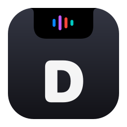
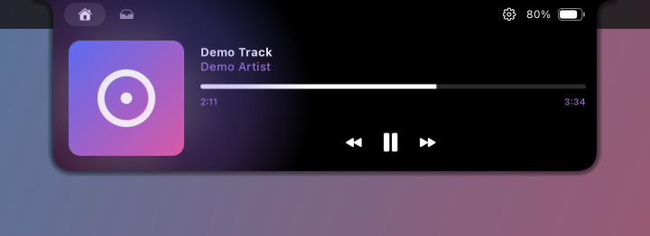
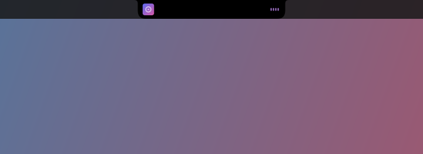
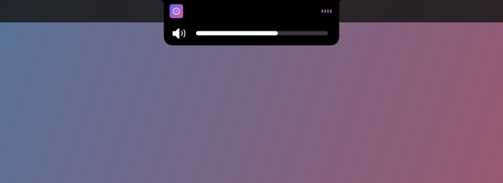
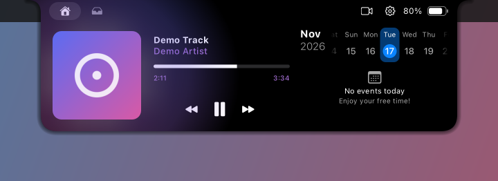
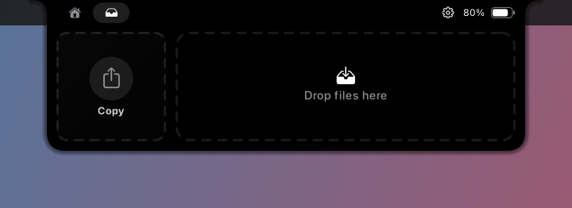

<div align="center">



# DedNotch

**A MacBook-style dynamic notch for the Linux desktop.**

Media controls, a file shelf, calendar, volume/brightness HUD and battery status —
all living in a small notch at the top of your screen.

[](LICENSE)


</div>

<p align="center">
  
</p>

## Features

- **Now playing** – works with any MPRIS player (Spotify, browsers, Rhythmbox, VLC, mpv, …):
  album art, progress bar with seeking, configurable control buttons, optional synced lyrics
  (via [lrclib.net](https://lrclib.net)) and an audio spectrum in the closed notch.
- **Sneak peek** – the notch briefly expands when a track changes.
- **Shelf** – drag files onto the notch to keep them handy, then drag them out again.
- **Calendar** – today's events from GNOME Calendar / Online Accounts, plus your own `.ics` files.
- **HUD** – volume, brightness and microphone changes shown inside the notch.
- **Battery** – charge level, charging state and power notifications (UPower).
- **Mirror** – a quick webcam preview from the notch.
- **Gestures & hover** – open on hover, or scroll down/up to open and close.
- **Highly configurable** – sizing, accent colour, shadows, tabs, multi-monitor support and more
  in a built-in settings window.

## Screenshots

| Closed | HUD |
| :---: | :---: |
|  |  |
| **Calendar** | **Shelf** |
|  |  |

## Requirements

- Linux with an **X11** session (Wayland sessions run through XWayland automatically)
- Best supported on **GNOME** (keyboard shortcuts and calendar integration use GNOME services)
- Python 3 with PyGObject and pycairo
- GTK 3, libwnck 3, GStreamer 1.0, WirePlumber (`wpctl`)
- Optional: Ayatana AppIndicator (for the top-bar icon)

On Debian / Ubuntu:

```sh
sudo apt install python3-gi python3-gi-cairo gir1.2-gtk-3.0 gir1.2-wnck-3.0 \
    gir1.2-gst-plugins-base-1.0 gir1.2-ayatanaappindicator3-0.1 wireplumber
```

## Installation

DedNotch installs for the current user only. No root is needed.

```sh
git clone https://github.com/ashiqurankan/dednotch.git
cd dednotch
./install.sh               # install
./install.sh --autostart   # install and start automatically at login
```

The installer checks dependencies and puts the app in `~/.local/lib/dednotch`. It adds a `dednotch`
launcher to `~/.local/bin` and an entry to your app grid.

### Run without installing

```sh
python3 -m dednotch
```

### Uninstall

```sh
./uninstall.sh            # keeps your settings
./uninstall.sh --purge    # also removes settings, data and cache
```

## Usage

Launch **DedNotch** from the app grid or run `dednotch`. Hover over or click the notch to open it.

| Command | Action |
| --- | --- |
| `dednotch --toggle` | Open / close the notch |
| `dednotch --open` / `--close` | Open or close the notch |
| `dednotch --settings` | Show the settings window |
| `dednotch --toggle-mic` | Toggle microphone mute |
| `dednotch --toggle-sneak-peek` | Toggle the sneak peek |
| `dednotch --quit` | Quit |

Default keyboard shortcuts (install them from **Settings → Shortcuts**):

| Shortcut | Action |
| --- | --- |
| <kbd>Ctrl</kbd>+<kbd>Shift</kbd>+<kbd>I</kbd> | Toggle notch |
| <kbd>Ctrl</kbd>+<kbd>Shift</kbd>+<kbd>H</kbd> | Toggle sneak peek |
| <kbd>Ctrl</kbd>+<kbd>Shift</kbd>+<kbd>M</kbd> | Toggle microphone |

Settings are stored in `~/.config/dednotch/settings.json`.

## Project layout

```
dednotch/
├── app.py              # application, coordinator, CLI options
├── notch.py            # the notch window and all of its views
├── settings_window.py  # settings UI
├── shelf.py            # file shelf
├── config.py           # defaults and settings store
├── gfx.py, anim.py     # drawing helpers and animations
├── services/           # media (MPRIS), battery, calendar, webcam, system
└── assets/             # icons and sounds
tools/
├── snapshot.py         # render notch states offscreen to PNG
├── make_icons.py       # regenerate app, tray and battery icons
└── make_sound.py       # regenerate the welcome chime
```

To regenerate the screenshots in `docs/` with neutral placeholder data:

```sh
python3 tools/snapshot.py --demo docs closed open shelf calendar hud
```

Then rename the `snap_*.png` files to match the README.

## License

Copyright © 2026 Ded Studio.

DedNotch is free software, released under the [GNU General Public License v3.0](LICENSE).

<p align="center"><sub>Made with love by Ded Studio</sub></p>

Based on [boring.notch](https://github.com/TheBoredTeam/boring.notch) (GPL-3.0). Thanks for the inspiration.
# dednotch
